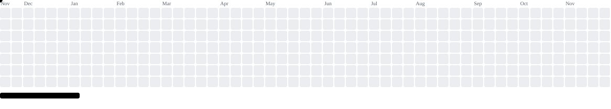

# Ícaro Ryan

Estudante de Engenharia de Software com interesse em desenvolvimento back-end.

### Tecnologias

### Projetos em destaque

| Projeto | Descrição | Tecnologias |
| --- | --- | --- |
| [Controle de Gastos](https://github.com/icar0x/Controle_Gastos) | API de receitas e despesas com regras de negócio, totais por pessoa e interface web. | C#, ASP.NET Core, PostgreSQL, React |
| [Poupança com Metas](https://github.com/icar0x/poupanca-metas) | Aplicação via terminal com metas financeiras, depósitos e integração com funções e procedures do banco. | Java, Spring Boot, JPA, PostgreSQL |
| [Catálogo com Cache](https://github.com/icar0x/catalogo-cache-supabase-redis) | CRUD de produtos com cache-aside, expiração, invalidação e métricas de cache. | Python, Streamlit, Supabase, Redis |
| [7 Barbershop](https://github.com/icar0x/7-barbershop-bd) | Sistema desktop de gestão com agendamentos, relatórios e dashboard integrado ao banco. | Java, Swing, JDBC, PostgreSQL |
| [E-commerce](https://github.com/icar0x/ecommerce-trabalho) | **Em desenvolvimento.** Projeto de catálogo com carrinho e envio de pedidos pelo WhatsApp. | Stack planejada: Python, Supabase, MongoDB, Redis |

<picture>
  <source media="(prefers-color-scheme: dark)" srcset="https://raw.githubusercontent.com/icar0x/icar0x/main/dist/breakout-contribution-graph-dark.svg">
  <source media="(prefers-color-scheme: light)" srcset="https://raw.githubusercontent.com/icar0x/icar0x/main/dist/breakout-contribution-graph.svg">
  
</picture>
